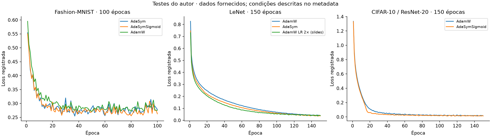

# AdaSym — optimization algorithm research

English | [Português (Brasil)](README.pt-BR.md)

Research on optimization algorithms developed within a machine learning and AI study group. The project brings together **symbolic discovery of update rules, NumPy and PyTorch implementations, and neural network experiments**.

AdaSym adapts the step size to the recent consistency of gradients. Its formulation combines gradient moments, adaptive normalization, and a denominator floor to control step amplification. The AdaSymSigmoid variant adds a time-dependent transition to the consistency correction.

[Notebook on Kaggle](https://www.kaggle.com/code/italocapuzzo/symbolic-optimizer-discovery-on-mnist-via-gp) · [Notebook code](notebooks/symbolic-optimizer-discovery-on-mnist-via-gp.ipynb) · [Formulation and rationale](docs/pesquisa.md)

## Project areas

- **Symbolic discovery:** search for mathematical expressions through genetic programming with DEAP.
- **Optimizer implementation:** NumPy and PyTorch update rules, moment states, and diagnostics.
- **Experimentation:** comparison of training curves with AdamW and hyperparameter studies.
- **Analysis and visualization:** scripts to consolidate data, generate plots, and examine update dynamics.

## Symbolic optimizer discovery

The **Symbolic Optimizer Discovery on MNIST via GP** notebook implements a search for update rules using **genetic programming with DEAP and PyTorch**. Each candidate is a mathematical expression built from the gradient and its first- and second-order moments.

- **Evolutionary search:** tournament selection, crossover, mutation, and preservation of the best individuals through elitism.
- **Neural network evaluation:** LeNet training on MNIST, with fitness based on the area under the validation loss curve relative to an AdamW baseline.
- **Complexity control:** expression-size penalties and tree-height limits.
- **Search analysis:** tracking fitness evolution, tree size, and formulas selected for the Hall of Fame.

This implementation documents the symbolic discovery part of the research and complements the AdaSym formulation and experiments in this repository. The [notebook guide](notebooks/README.md) explains the code structure and how to run it.

## Update rule

$$d=\max\left(v-s\cdot m_2^2,\frac{v}{c}\right),\qquad \theta_{k+1}=\theta_k-\eta\frac{m_1}{\sqrt d}.$$

| Term | Role |
|---|---|
| `m1` | Average of gradients that defines the update direction |
| `v` | Average of squared gradients |
| `m2` | Memory of the recent gradient direction |
| `s` | Weight of the consistency correction |
| `c` | Floor divisor that controls step amplification |
| `eta` | Learning rate |

The consistency correction adjusts the denominator according to the recent gradient direction. The `v/c` floor controls the update scale. In the AdaSymSigmoid variant, the correction weight follows a decreasing sigmoid over the epochs.

## Experiments and analysis

| Area | Configuration |
|---|---|
| Symbolic search | LeNet and MNIST, genetic programming with DEAP and PyTorch |
| Optimizer comparison | LeNet on Fashion-MNIST and ResNet-20 on CIFAR-10, with AdamW as a reference |
| Hyperparameters | Learning rate, moment coefficients, sigmoid transition, and denominator floor |
| Curve analysis | Training loss, area under the curve, and evolution across epochs |



Analysis scripts consolidate the records into tables and figures. Data is in `data/original/`, and reports are in `results/`.

## Run

Requires Python 3.10 or newer. From the repository root:

```bash
python -m venv .venv
# Windows PowerShell:
.venv\Scripts\Activate.ps1
python -m pip install -e ".[plots,torch]"
```

To analyze the data and generate experiment summaries:

```bash
python scripts/analyze_original.py
python scripts/summarize_author_experiments.py
```

To run the implementation tests and synthetic experiment:

```bash
python -m unittest discover -s tests -v
python scripts/run_synthetic.py --epochs 35 --output results/runs/synthetic
```

The [notebook guide](notebooks/README.md) covers running the symbolic search on Kaggle and locally.

### PyTorch example

The implementation below uses the common-window variant:

```python
from optimizer_research import Config
from optimizer_research.torch_optimizer import AdaSymTorch

optimizer = AdaSymTorch(model.parameters(), Config(
    lr=1e-3, beta_window=0.9, cap=4,
    alpha=1.0, warmup_steps=20, rule="linear",
))
for inputs, targets in train_loader:
    optimizer.zero_grad()
    loss = criterion(model(inputs), targets)
    loss.backward()
    optimizer.step()
```

Sigmoid mode uses `optimizer.set_progress(step / max(total_steps - 1, 1))` before each step.

### Fashion-MNIST experiments

```bash
python scripts/run_fashion_mnist.py --download --method linear --epochs 30 --seed 101
python scripts/run_fashion_mnist.py --method adamw --epochs 30 --seed 101
python scripts/run_fashion_mnist.py --method adamw_scaled --epochs 30 --seed 101
```

## Structure

| Folder | Contents |
|---|---|
| `notebooks/` | Symbolic search with DEAP/PyTorch and execution guide |
| `docs/` | Mathematical formulation and research documentation |
| `src/optimizer_research/` | Optimizers, grammar, and synthetic MLP |
| `scripts/` | Analysis, plots, and experiments |
| `tests/` | Tests of the update rule and implementation |
| `data/original/` | NumPy arrays and experiment metadata |
| `references/` | Research presentation |
| `results/` | Reports, logs, and figures |

The `.github/workflows/tests.yml` workflow runs the tests on GitHub Actions.
