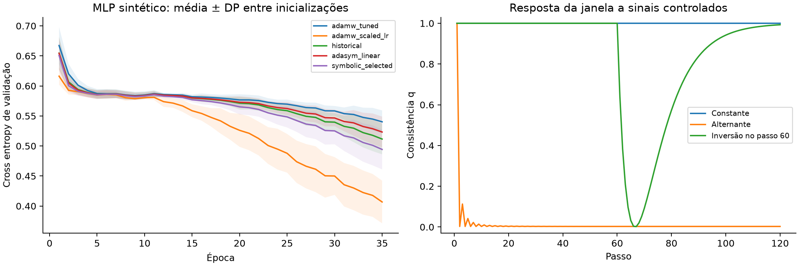

# Optimizer Research · AdaSym

Pesquisa sobre **otimizadores com uma janela de consistência dos gradientes**, usando busca simbólica para explorar e restringir as regras de atualização.

A ideia central é amplificar o passo quando direção e magnitude do gradiente persistem. Esta revisão transforma essa hipótese em uma definição matemática, implementações executáveis e um protocolo de validação. O projeto ainda é exploratório: o primeiro teste sintético não mostrou vantagem sobre AdamW com taxa de aprendizado maior.

**Comece pela [pesquisa completa](docs/pesquisa.md)** ou abra `LEIA-ME.html` no navegador. Consulte também o [mapa dos testes recebidos](docs/mapa_experimentos.md), o [protocolo de experimentos](docs/protocolo.md), a [proveniência](docs/proveniencia.md) e os resultados abaixo.

## Formulação

Uma janela comum calcula as médias exponenciais de g e g², com correção de viés. A consistência por coordenada é

$$q = \mathrm{clip}\left(\frac{\widehat{E[g]}^2}{\widehat{E[g^2]}+\epsilon^2},0,1\right).$$

O denominador do AdamW passa a ser

$$d=\widehat v\max(1-a\,h(q),1/c), \qquad \Delta\theta_{\mathrm{adapt}}=-\eta\frac{\widehat m}{\sqrt d+\epsilon}.$$

Para h crescente em [0,1], maior consistência permite maior passo relativo, limitado por sqrt(c). **O limite relativo não é uma garantia de convergência.** Alpha=0 ou c=1 recupera AdamW. O weight decay permanece desacoplado. A função principal é h(q)=q. A busca pequena também explora raiz, quadrado, racional e tangente hiperbólica normalizada.

## Resultados disponíveis

- [Auditoria dos arrays originais](results/historical/report.md): estatísticas descritivas, arquivos inválidos e lacunas de identificação. Nenhuma alegação de superioridade ou significância foi inferida das curvas incompletas.
- [Teste novo em MLP sintético](results/synthetic/report.md): triagem por validação, cinco inicializações de confirmação e controle de LR maior. Todos os logs estão em `results/synthetic/runs.json`.
- [Verificação da implementação](results/verification.md): testes de recorrência, limites, gradientes, paridade NumPy/PyTorch e checkpoint.



## Executar

Python 3.10 ou superior. No terminal, dentro desta pasta:

```bash
python -m venv .venv
# Windows PowerShell:
.venv\Scripts\Activate.ps1
python -m pip install -e ".[plots]"
python -m unittest discover -s tests -v
python scripts/analyze_original.py
python scripts/run_synthetic.py --epochs 35 --output results/runs/synthetic
```

O núcleo e o MLP sintético dependem apenas de NumPy. O gerador de gráficos lê a execução de referência em `results/synthetic`. Para refazer os gráficos dessa execução:

```bash
python scripts/run_synthetic.py --epochs 35 --output results/synthetic
python scripts/plot_results.py
```

### PyTorch

```bash
python -m pip install -e ".[torch]"
python -m unittest discover -s tests -v
```

```python
from optimizer_research import Config
from optimizer_research.torch_optimizer import AdaSymTorch

optimizer = AdaSymTorch(model.parameters(), Config(
    lr=1e-3, beta_window=0.9, cap=4,
    alpha=1.0, warmup_steps=20, rule="linear",
))
for inputs, targets in train_loader:
    optimizer.zero_grad()
    loss = criterion(model(inputs), targets)
    loss.backward()
    optimizer.step()
```

O modo sigmoide requer `optimizer.set_progress(step / max(total_steps - 1, 1))` antes de cada passo. Gradientes ausentes pulam atualização e weight decay. Gradientes esparsos ou complexos não são suportados. A implementação mantém quatro estados de momento e coleta diagnósticos que podem sincronizar a GPU. É uma referência de pesquisa, sem otimizações de desempenho.

Para um teste piloto em Fashion-MNIST, consulte `scripts/run_fashion_mnist.py`. Esse script baixa o dataset somente com `--download`. Ele é uma nova implementação de LeNet, não uma recuperação do modelo histórico. A entrega inclui sua verificação funcional com dados artificiais, mas não resultados novos de Fashion-MNIST/CIFAR-10.

```bash
# Piloto com treino e validação, sem consultar o teste oficial:
python scripts/run_fashion_mnist.py --download --method linear --epochs 30 --seed 101
python scripts/run_fashion_mnist.py --method adamw --epochs 30 --seed 101
python scripts/run_fashion_mnist.py --method adamw_scaled --epochs 30 --seed 101
# Usar --evaluate-test apenas depois de congelar fórmula e hiperparâmetros.
```

O gerador de `LEIA-ME.html` requer `python -m pip install -e ".[docs]"` e pode ser executado com `python scripts/build_reading_copy.py`. A cópia entregue já está pronta e funciona offline.

## Organização

| Pasta | Conteúdo |
|---|---|
| `docs/` | Fundamentação, protocolo e proveniência |
| `src/optimizer_research/` | Otimizadores, gramática e MLP sintético |
| `scripts/` | Auditoria, triagem, gráficos e piloto em visão |
| `tests/` | Testes da regra e da implementação |
| `data/original/` | Fontes NumPy e metadados preservados |
| `references/` | Apresentação original |
| `results/` | Relatórios, logs e figuras reproduzíveis |

O arquivo `.github/workflows/tests.yml` deixa os testes preparados para uma publicação futura. Esta entrega é local e não foi enviada ao GitHub. A autoria e a licença de distribuição devem ser definidas antes de uma publicação aberta.
