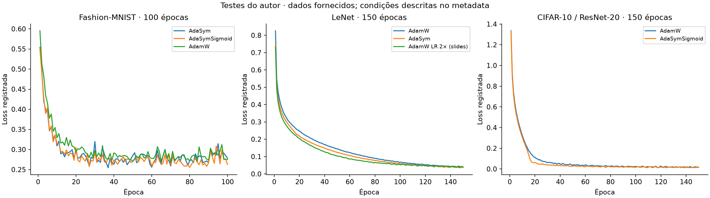

# AdaSym — pesquisa em algoritmos de otimização

Pesquisa em algoritmos de otimização desenvolvida em um grupo de estudos de machine learning e IA em parceria com a Neospace. O projeto reúne **descoberta simbólica de regras de atualização, implementações em NumPy e PyTorch e experimentos com redes neurais**.

O AdaSym adapta o tamanho do passo à consistência recente dos gradientes. A formulação combina momentos do gradiente, normalização adaptativa e um piso no denominador para controlar a amplificação do passo. A variante AdaSymSigmoid incorpora uma transição temporal da correção de consistência.

[Notebook no Kaggle](https://www.kaggle.com/code/italocapuzzo/symbolic-optimizer-discovery-on-mnist-via-gp) · [Código do notebook](notebooks/symbolic-optimizer-discovery-on-mnist-via-gp.ipynb) · [Formulação e fundamentação](docs/pesquisa.md)

## Frentes do projeto

- **Descoberta simbólica:** busca de expressões matemáticas por programação genética com DEAP.
- **Implementação de otimizadores:** regras de atualização em NumPy e PyTorch, estados de momento e diagnósticos.
- **Experimentação:** comparação de curvas de treinamento com AdamW e estudo de hiperparâmetros.
- **Análise e visualização:** scripts para consolidar dados, gerar gráficos e examinar a dinâmica das atualizações.

## Descoberta simbólica de otimizadores

O notebook **Symbolic Optimizer Discovery on MNIST via GP** implementa uma busca por regras de atualização usando **programação genética com DEAP e PyTorch**. Cada candidato é uma expressão matemática construída a partir do gradiente e dos momentos de primeira e segunda ordem.

- **Busca evolutiva:** seleção por torneio, cruzamento, mutação e preservação dos melhores indivíduos por elitismo.
- **Avaliação em redes neurais:** treinamento de uma LeNet em MNIST, com fitness baseado na área sob a curva de perda de validação em relação a um baseline AdamW.
- **Controle da complexidade:** penalização do tamanho das expressões e limites de altura das árvores.
- **Análise da busca:** acompanhamento da evolução do fitness, tamanho das árvores e fórmulas selecionadas no Hall of Fame.

Essa implementação documenta a frente de descoberta simbólica da pesquisa e complementa a formulação e os experimentos do AdaSym apresentados neste repositório. O [guia do notebook](notebooks/README.md) explica a organização do código e como executá-lo.

## Regra de atualização

$$d=\max\left(v-s\cdot m_2^2,\frac{v}{c}\right),\qquad \theta_{k+1}=\theta_k-\eta\frac{m_1}{\sqrt d}.$$

| Termo | Papel |
|---|---|
| `m1` | Média dos gradientes que define a direção da atualização |
| `v` | Média dos gradientes ao quadrado |
| `m2` | Memória da direção recente dos gradientes |
| `s` | Peso da correção de consistência |
| `c` | Divisor do piso que controla a amplificação do passo |
| `eta` | Taxa de aprendizado |

A correção de consistência ajusta o denominador conforme a direção recente dos gradientes. O piso `v/c` controla a escala da atualização. Na variante AdaSymSigmoid, o peso da correção segue uma sigmoide decrescente ao longo das épocas.

## Experimentos e análises

| Frente | Configuração |
|---|---|
| Busca simbólica | LeNet e MNIST, programação genética com DEAP e PyTorch |
| Comparação de otimizadores | LeNet em Fashion-MNIST e ResNet-20 em CIFAR-10, com AdamW como referência |
| Hiperparâmetros | Taxa de aprendizado, coeficientes de momento, transição da sigmoide e piso do denominador |
| Análise das curvas | Perda de treinamento, área sob a curva e evolução ao longo das épocas |



Os scripts de análise consolidam os registros em tabelas e figuras. Os dados estão em `data/original/` e os relatórios em `results/`.

## Executar

Requer Python 3.10 ou superior. Na raiz do repositório:

```bash
python -m venv .venv
# Windows PowerShell:
.venv\Scripts\Activate.ps1
python -m pip install -e ".[plots,torch]"
```

Para analisar os dados e gerar os resumos dos experimentos:

```bash
python scripts/analyze_original.py
python scripts/summarize_author_experiments.py
```

Para executar os testes da implementação e o experimento sintético:

```bash
python -m unittest discover -s tests -v
python scripts/run_synthetic.py --epochs 35 --output results/runs/synthetic
```

O [guia do notebook](notebooks/README.md) apresenta a execução da busca simbólica no Kaggle e em ambiente local.

### Exemplo em PyTorch

A implementação abaixo utiliza a variante de janela comum:

```python
from optimizer_research import Config
from optimizer_research.torch_optimizer import AdaSymTorch

optimizer = AdaSymTorch(model.parameters(), Config(
    lr=1e-3, beta_window=0.9, cap=4,
    alpha=1.0, warmup_steps=20, rule="linear",
))
for inputs, targets in train_loader:
    optimizer.zero_grad()
    loss = criterion(model(inputs), targets)
    loss.backward()
    optimizer.step()
```

O modo sigmoide utiliza `optimizer.set_progress(step / max(total_steps - 1, 1))` antes de cada passo.

### Experimentos em Fashion-MNIST

```bash
python scripts/run_fashion_mnist.py --download --method linear --epochs 30 --seed 101
python scripts/run_fashion_mnist.py --method adamw --epochs 30 --seed 101
python scripts/run_fashion_mnist.py --method adamw_scaled --epochs 30 --seed 101
```

## Organização

| Pasta | Conteúdo |
|---|---|
| `notebooks/` | Busca simbólica com DEAP/PyTorch e guia de execução |
| `docs/` | Formulação matemática e documentação da pesquisa |
| `src/optimizer_research/` | Otimizadores, gramática e MLP sintético |
| `scripts/` | Análises, gráficos e experimentos |
| `tests/` | Testes da regra de atualização e da implementação |
| `data/original/` | Arrays NumPy e metadados dos experimentos |
| `references/` | Apresentação da pesquisa |
| `results/` | Relatórios, logs e figuras |

O workflow `.github/workflows/tests.yml` executa os testes no GitHub Actions.
