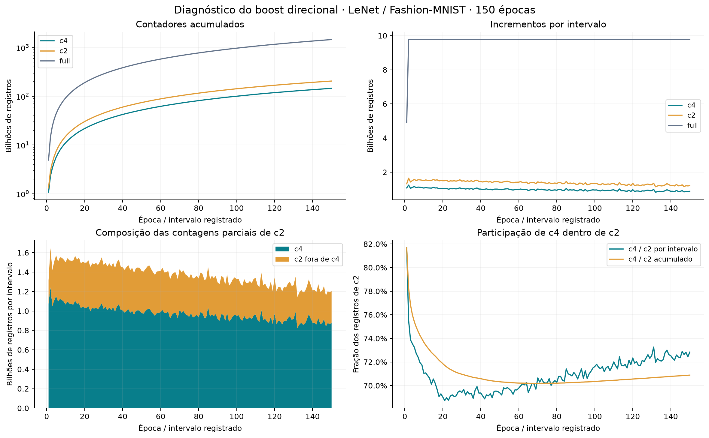
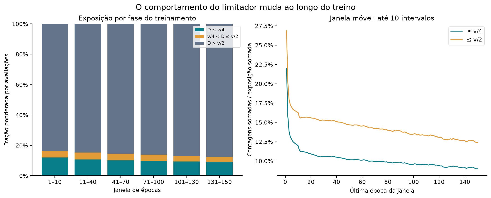

# AdaSym — pesquisa experimental em otimização

[English](README.md) | Português (Brasil)

Pesquisa em algoritmos de otimização para machine learning, desenvolvida por **Ítalo Capuzzo** em um grupo de estudos de machine learning e IA. O projeto combina **descoberta simbólica, experimentação com redes neurais e ciência de dados** para investigar regras de atualização adaptativas.

A análise de curvas de loss, varreduras de hiperparâmetros e estatísticas internas do otimizador orienta a identificação de padrões e a revisão das hipóteses. Esse processo acompanha a evolução da fórmula do AdaSym, desde a expressão descoberta até a incorporação de memória direcional, limitação do boost e ponderação temporal.

[Análise dos experimentos](results/research/report.md) · [Notebook de diagnóstico](notebooks/threshold-diagnostics.ipynb) · [Formulação](docs/pesquisa.md) · [Busca simbólica no Kaggle](https://www.kaggle.com/code/italocapuzzo/symbolic-optimizer-discovery-on-mnist-via-gp)

## Ciência de dados: diagnóstico do boost e sensibilidade do threshold

O diagnóstico interno do AdaSym é um estudo central do projeto. A pergunta é **como o boost direcional se distribui entre as faixas monitoradas e como esse comportamento muda durante o treinamento**. A investigação utiliza os contadores `AdaSym_fminist_c4`, `c2` e `full`, registrados em **LeNet/Fashion-MNIST durante 150 épocas**, com piso `v/4`.

### Dados e tratamento

O mecanismo de consistência dos gradientes produz um boost por coordenada. `full` está associado ao boost integral limitado pelo threshold; `c4` e `c2` acompanham faixas de boost parcial relacionadas a `v/4` e `v/2`, com **`c4` incluído em `c2`**.

| Etapa da análise | Aplicação no diagnóstico |
|---|---|
| Organização e validação | Conferência dos formatos, contagens acumuladas e inclusão de `c4` em `c2` |
| Transformação temporal | Diferenças sucessivas para obter os incrementos de cada intervalo |
| Construção de medidas | Contagens por faixa, composição interna de `c2` e agregação por fase |
| Análise exploratória | Comparação de séries acumuladas, incrementos e janelas móveis |
| Interpretação | Identificação de padrões temporais e relação com o mecanismo da fórmula |

Essa organização separa o crescimento natural das séries acumuladas das mudanças no comportamento do boost por intervalo.



### Resultados e padrões identificados

Os registros acumulados de `c2` são decompostos em duas partes: `c4` e `c2` fora de `c4`. Essa partição evita dupla contagem e permite estudar a composição das faixas de boost parcial.

| Composição dos registros de `c2` | Contagem acumulada | Participação dentro de `c2` |
|---|---:|---:|
| `c4` | 145.766.992.885 | 70,89% |
| `c2` fora de `c4` | 59.869.969.114 | 29,11% |

A composição também muda ao longo do treinamento:

| Janela de épocas | Participação de `c4` dentro de `c2` |
|---|---:|
| 1–10 | 73,67% |
| 11–40 | 69,54% |
| 41–70 | 69,63% |
| 71–100 | 70,75% |
| 101–130 | 71,85% |
| 131–150 | 72,52% |

**O padrão apresenta uma redução inicial da participação de `c4`, seguida de recuperação nas fases posteriores.** Portanto, o comportamento das faixas de boost parcial varia com a fase do treino. Um único percentual acumulado resume o experimento, mas a análise temporal revela a estrutura dessa mudança.



As proporções das janelas são calculadas pela razão entre as contagens somadas. A janela móvel examina até dez intervalos consecutivos, permitindo acompanhar a mudança de composição em uma escala temporal mais curta.

### Diagnóstico interno e resultado do treinamento

A investigação combina as estatísticas internas com métricas das curvas de loss. A AUC normalizada descreve a curva inteira; a média das últimas 20 épocas descreve o comportamento tardio.

| Experimento | Método | AUC normalizada | Loss média nas últimas 20 épocas |
|---|---|---:|---:|
| LeNet / Fashion-MNIST | AdamW | 0,133193 | 0,043519 |
| LeNet / Fashion-MNIST | AdaSym | 0,118643 | 0,039634 |
| ResNet-20 / CIFAR-10 | AdamW | 0,077817 | 0,018017 |
| ResNet-20 / CIFAR-10 | AdaSymSigmoid | 0,065551 | 0,015440 |

Nas configurações apresentadas, as variantes AdaSym registram valores menores nos dois resumos. A leitura conjunta examina **o funcionamento do mecanismo e o comportamento experimental do treinamento**: os contadores descrevem as faixas de boost, enquanto as losses descrevem a trajetória de otimização.

### Relação com a evolução da fórmula

A análise do boost integra o processo de investigação desenvolvido por Ítalo Capuzzo. O diagnóstico das faixas, sua evolução temporal e a comparação das curvas participam da identificação de padrões e da revisão das hipóteses sobre amplificação, memória direcional e ponderação temporal. A ciência de dados aparece, assim, como parte da metodologia usada para desenvolver e investigar a regra de atualização.

[Notebook executado](notebooks/threshold-diagnostics.ipynb) · [Contadores por época](results/research/threshold_by_epoch.csv) · [Composição por fase](results/research/threshold_windows.csv) · [Relatório completo](results/research/report.md)

## Regra de atualização

O AdaSym adapta o tamanho do passo à consistência recente dos gradientes em cada coordenada. Uma memória direcional persistente reduz o denominador da atualização, produzindo um **boost element-wise**. O piso relativo `v/c` limita essa amplificação.

$$d=\max\left(v-s\,m_2^2,\frac{v}{c}\right),\qquad \theta_{k+1}=\theta_k-\eta\frac{m_1}{\sqrt d}.$$

| Componente | Função |
|---|---|
| `m1` | Direção da atualização, obtida da memória dos gradientes |
| `v` | Escala de normalização baseada nos gradientes ao quadrado |
| `m2` | Memória direcional usada na correção do denominador |
| `s` | Peso da correção; pode variar durante o treinamento |
| `c` | Controle do piso e da amplificação máxima |
| `eta` | Taxa de aprendizado |

Na variante **AdaSymSigmoid**, uma sigmoide reduz gradualmente a participação da correção direcional ao longo das épocas.

## Análise de dados na evolução da fórmula

Os experimentos investigam tanto o resultado do treinamento quanto o funcionamento interno do otimizador. A comparação das curvas avalia a dinâmica de convergência; os contadores de boost examinam como a regra atua sobre as coordenadas; as varreduras estudam sua resposta aos hiperparâmetros.

| Etapa da formulação | Aspecto investigado |
|---|---|
| Expressão obtida por busca simbólica | Estruturas candidatas para a atualização |
| Memória ao quadrado no denominador | Relação entre memória direcional e escala dos gradientes |
| Piso relativo `v/c` | Controle da amplificação do passo |
| Memória separada `m2` | Resposta da correção a seus próprios coeficientes |
| Peso temporal por sigmoide | Evolução da correção durante o treinamento |

Essa sequência representa um processo de investigação orientado por dados: observação de padrões, comparação de variantes e revisão da regra de atualização.

## Experimentos e comparações

| Frente | Dados e análise |
|---|---|
| Comparação de otimizadores | AdaSym, AdaSymSigmoid e AdamW em Fashion-MNIST e CIFAR-10 |
| Dinâmica de treinamento | Curvas de loss, AUC normalizada e comportamento nas últimas épocas |
| Boost por coordenada | Séries acumuladas, incrementos e composição dos contadores |
| Sensibilidade aos hiperparâmetros | Learning rate, coeficientes de memória e transição da sigmoide |
| Descoberta simbólica | Evolução do fitness, tamanho das expressões e fórmulas selecionadas |


O [relatório de análise](results/research/report.md) reúne tabelas e interpretações. Os resultados são acompanhados por CSVs, figuras PNG/SVG e um manifesto com os hashes dos dados e os parâmetros da análise.

## Descoberta simbólica

O notebook **Symbolic Optimizer Discovery on MNIST via GP** explora expressões construídas a partir do gradiente e de seus momentos, usando programação genética com DEAP e PyTorch.

- Seleção por torneio, cruzamento, mutação e elitismo.
- Avaliação de candidatos em LeNet/MNIST por loss de validação relativa a AdamW.
- Controle de complexidade e profundidade das expressões.
- Acompanhamento do fitness e das fórmulas selecionadas.

[Código do notebook](notebooks/symbolic-optimizer-discovery-on-mnist-via-gp.ipynb) · [Guia de execução](notebooks/README.pt-BR.md)

## Executar

Requer Python 3.10 ou superior. Na raiz do repositório:

```bash
python -m venv .venv
# Git Bash no Windows:
source .venv/Scripts/activate
python -m pip install -e ".[plots,docs]"
python scripts/analyze_research.py
```

O comando gera o relatório, os gráficos e as tabelas em `results/research/`. O notebook `notebooks/threshold-diagnostics.ipynb` permite percorrer a análise em um ambiente Jupyter.

```bash
python -m unittest discover -s tests -v
python scripts/run_synthetic.py --epochs 35 --output results/runs/synthetic
```

Para os experimentos em PyTorch:

```bash
python -m pip install -e ".[torch]"
python scripts/run_fashion_mnist.py --download --method linear --epochs 30 --seed 101
python scripts/run_fashion_mnist.py --method adamw --epochs 30 --seed 101
```

## Organização

| Pasta | Conteúdo |
|---|---|
| `data/original/` | Registros NumPy dos experimentos |
| `notebooks/` | Descoberta simbólica e diagnóstico do boost |
| `src/optimizer_research/` | Implementações NumPy/PyTorch e funções de análise |
| `scripts/` | Análises, visualizações e experimentos |
| `results/research/` | Relatório, tabelas, figuras e proveniência |
| `docs/` | Formulação e metodologia |
| `references/` | Apresentação da pesquisa |
| `tests/` | Verificação das implementações e dos cálculos |
