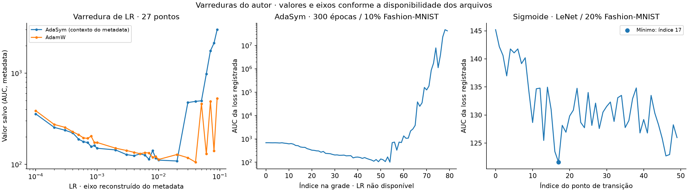
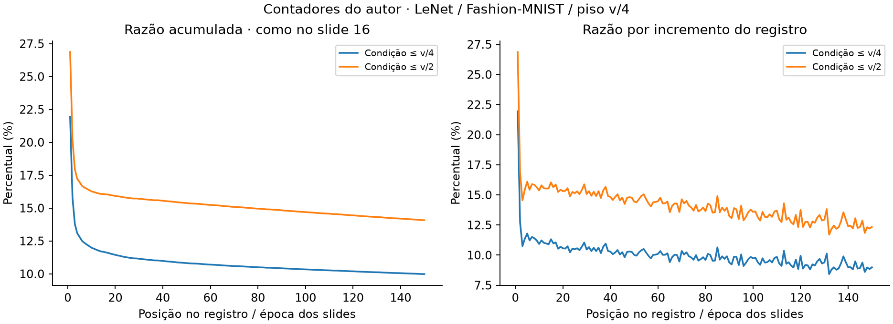

# Testes realizados pelo autor

Esta seção incorpora os experimentos já realizados na pesquisa AdaSym. As condições vêm de `data/original/metadata.txt` e da apresentação AdaSym. Os números abaixo foram recalculados a partir dos arrays fornecidos. A revisão não executou novamente esses treinamentos.

A loss é apresentada conforme registrada. Nas matrizes 3 × 150, as tabelas agregam as três trajetórias, como os gráficos de média e desvio padrão dos slides. No arquivo 3 × 100, cada linha corresponde a um otimizador. A média da loss ao longo das épocas descreve a curva inteira e não equivale à loss final, à acurácia nem à AUC original dos vetores de varredura.

## 1. Fashion-MNIST: AdaSym, AdaSymSigmoid e AdamW

**Condição registrada:** Fashion-MNIST, 100 épocas. Arquivo `losses_FashionMNIST.npy`, slides 8 e 9. A ordem das linhas abaixo é inferida pela correspondência dos valores com esses gráficos.

| Método | Loss na época 100 | Média das últimas 10 épocas | Média nas 100 épocas |
|---|---:|---:|---:|
| AdaSym | 0.278333 | 0.290194 | 0.291404 |
| AdaSymSigmoid | 0.262625 | 0.282255 | 0.287134 |
| AdamW | 0.275254 | 0.289600 | 0.302175 |

**Leitura:** AdaSymSigmoid apresenta a menor média da loss ao longo das épocas e nas últimas dez épocas desse teste. A diferença entre AdaSym sem sigmoide e AdamW depende do resumo usado: AdaSym tem média da curva menor, mas AdamW tem média ligeiramente menor nas últimas dez épocas. Isso favorece uma comparação por trajetória, além de um único ponto final.

## 2. LeNet em Fashion-MNIST: comparação de 150 épocas

**Condições no metadata:** LeNet, Fashion-MNIST, 150 épocas e LR 1e-3. O texto cita uma execução sem redução por sigmoide ou exponencial e, em outro trecho, piso v/4, valores (0,75; 0,35) e sigmoide por época. A associação exata desses trechos às variantes deve seguir o código original quando ele estiver disponível. O arquivo `AdaSym_loss_fmnist_nored.npy` identifica explicitamente a variante sem redução temporal pelo nome.

| Resultado salvo | Média das últimas 10 épocas | Média nas 150 épocas |
|---|---:|---:|
| AdamW | 0.041992 | 0.135194 |
| AdaSym | 0.038349 | 0.120462 |
| AdaSym, arquivo nored | 0.038083 | 0.117264 |

**Leitura:** as duas curvas AdaSym registram médias menores que AdamW nesse conjunto de arquivos, tanto na curva inteira quanto no trecho final. O teste documenta a comparação do autor; a interpretação como ganho de generalização depende de identificar se a loss é de treino, validação ou teste.

## 3. CIFAR-10: AdaSymSigmoid contra AdamW

**Condições no metadata:** CIFAR-10, ResNet-20, 150 épocas, LR 1e-3, weight decay 1e-2, sigmoide com transição na época 15 e piso v/8. Arquivos `AdamW_losses_cifar10.npy` e `AdaSymSig_losses_cifar10.npy`, slides 12 e 13.

| Método | Média das últimas 10 épocas | Média nas 150 épocas |
|---|---:|---:|
| AdamW | 0.017411 | 0.081801 |
| AdaSymSigmoid | 0.015382 | 0.069594 |

**Leitura:** AdaSymSigmoid tem menor média de loss nos dois resumos. As curvas preservam a melhoria inicial e a aproximação entre métodos no fim do treinamento, conforme os slides. Não há uma curva de acurácia correspondente nesses arquivos.

## 4. Controle de tamanho do passo: AdamW com LR 2×

**Condição relatada:** LeNet, 150 épocas e AdamW com o dobro da LR. O metadata diz MNIST e os slides 14 e 15 dizem Fashion-MNIST. Mantém-se essa diferença de rótulo sem alterar os dados. `Adam_losses2x.npy` é o nome original do arquivo.

| Método / arquivo | Média das últimas 10 épocas | Média nas 150 épocas |
|---|---:|---:|
| AdamW LR 2×, rótulo dos slides | 0.041124 | 0.109575 |
| AdaSym | 0.038349 | 0.120462 |

**Leitura:** o controle LR 2× tem menor média sobre toda a curva, enquanto AdaSym tem menor média no trecho final. O próprio histórico do autor já permite perguntar se a vantagem desejada é aceleração inicial, qualidade tardia ou ambas. Esse controle deve acompanhar qualquer conclusão sobre a janela de consistência.

## 5. Varreduras de learning rate

**Varredura AdaSym de 80 posições:** o metadata informa 300 épocas, 10% de Fashion-MNIST, AUC de loss, WD 1e-2 e valores b1/b2 = (0,75; 0,35). O papel desses dois coeficientes é preservado conforme o texto, sem atribuí-los automaticamente aos momentos do Adam. Arquivo `lrs_AdaSym_aucloss.npy`.

O menor valor é **101.313248**, no índice **54** (índice zero). Como a grade de 80 LRs não acompanha o material, esse mínimo não recebe uma LR inventada.

**Varredura comparativa de 27 posições:** `lrs_aucloss.npy` e `lrs_aucloss_adamW.npy`. O metadata fornece uma grade de 27 LRs de 1e-4 a 9e-2. O trecho próximo inclui `sigmoid(15 − época)` e piso v/8, mas não especifica todas as condições dessa rodada.

| Vetor | Mínimo registrado | Índice zero | LR pela grade do metadata |
|---|---:|---:|---:|
| lrs_aucloss.npy | 109.020409 | 19 | 0.02 |
| lrs_aucloss_adamW.npy | 105.941498 | 21 | 0.04 |

A correspondência dos 27 pontos com essa grade é uma inferência apoiada pelo tamanho do vetor e pela descrição. O primeiro vetor é associado à variante AdaSym pelo contexto do metadata. O slide 17 usa o rótulo “média das últimas 15 losses”, enquanto o texto descreve AUC e uma faixa maior de LRs. Por isso, o gráfico novo abaixo mostra os valores salvos com seu significado declarado no metadata, sem afirmar que reproduz exatamente o pós-processamento daquele slide.

## 6. Momento de transição da sigmoide

**Condições:** LeNet, 20% de Fashion-MNIST, 150 épocas, LR 1e-3 e WD 1e-2. O metadata descreve a varredura do ponto médio da sigmoide na faixa 0–50. Arquivo `lim_aucloss.npy`, com 50 valores.

O menor valor registrado é **121.601784**, no índice **17**. O eixo exato com seus endpoints não foi salvo. O resultado é identificado pelo índice; se a grade original era 0, 1, …, 49, esse ponto corresponde à transição na época 17.

**Leitura:** esse teste investiga por quanto tempo manter o incentivo à consistência. A sigmoide começa próxima de 1, passa por 0,5 no ponto de transição e se aproxima de zero depois dele.

## 7. Busca dos coeficientes de m2

O metadata identifica duas grades para procurar os melhores valores de beta3 e beta4 de m2. Os mínimos recalculados coincidem com as marcações dos slides 18 e 19.

| Grade | Shape | Mínimo finito | beta3 | beta4 | Valores inválidos |
|---|---|---:|---:|---:|---:|
| loss_matrix.npy | 10 × 70 | 15.459559 | 0.584341 | 0.740568 | 70 |
| loss_matrix (1).npy | 10 × 70 | 14.534201 | 0.674355 | 0.406159 | 0 |

As faixas exatas estão no mapa dos experimentos. Esses mínimos descrevem a varredura do autor. Sem a recorrência de m2 e a definição completa do fitness, os coeficientes não são convertidos em uma nova EMA nem recomendados como configuração universal.

## 8. Frequência de ativação do piso

**Condições:** LeNet, Fashion-MNIST, piso v/4. Arquivos `AdaSym_fminist_c2.npy`, `AdaSym_fminist_c4.npy` e `AdaSym_fminist_full.npy`. O metadata cita 1550 épocas, mas os vetores têm 150 posições, como o eixo do slide 16.

| Contador | Interpretação pelo slide e metadata | Razão acumulada final |
|---|---|---:|
| c4 / full | Condição associada ao piso v/4 | 9.9777% |
| c2 / full | Condição associada a ≤v/2 | 14.0758% |

O gráfico do slide 16 identifica as séries como acumuladas. A frequência em uma época isolada deve usar o incremento do contador dividido pelo incremento de full. A razão acumulada final mostra quanto o mecanismo de piso participou do treinamento, e não uma fração de runs ou de épocas.

## 9. Varredura do divisor do piso

O metadata registra um teste `div_aucloss`: LeNet, 20% de Fashion-MNIST, 150 épocas, LR 1e-3, WD 1e-2, sem decaimento temporal e divisores de 2 a 20. O teste faz parte do percurso relatado pelo autor. O arquivo correspondente não foi fornecido, portanto seu resultado numérico permanece pendente de recuperação.

## Síntese dos testes do autor

Os dados documentam comparações entre AdaSym, AdaSymSigmoid e AdamW, um controle de LR 2×, varreduras de LR, do ponto de transição da sigmoide e dos coeficientes de m2, além da frequência de acionamento do piso. A variante sigmoide apresenta losses menores nos resumos dos testes de 100 épocas em Fashion-MNIST e de 150 épocas em CIFAR-10. O controle LR 2× explicita um compromisso entre a curva inteira e seu trecho final.

Esses são resultados existentes da pesquisa. A identificação de splits, seeds e recorrências é necessária para aprofundar as conclusões, mas não elimina os experimentos realizados. A auditoria técnica e as diferenças de metadata permanecem em `results/historical/report.md`. O ensaio sintético desta revisão está documentado separadamente e não substitui os testes do autor.
