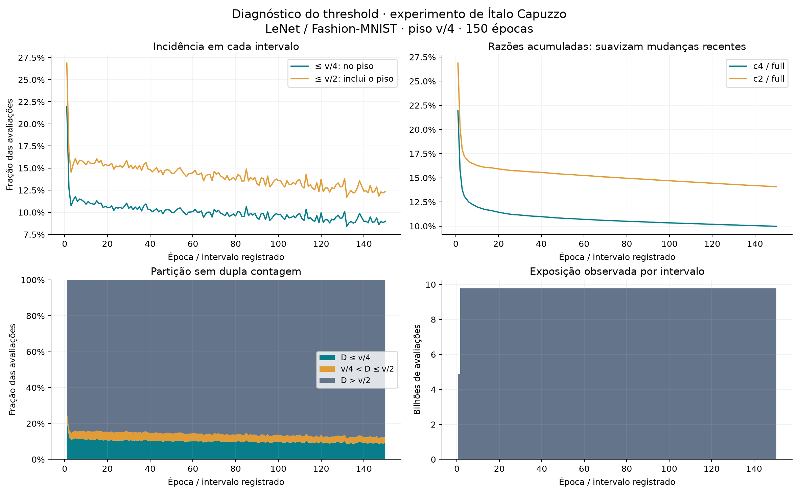
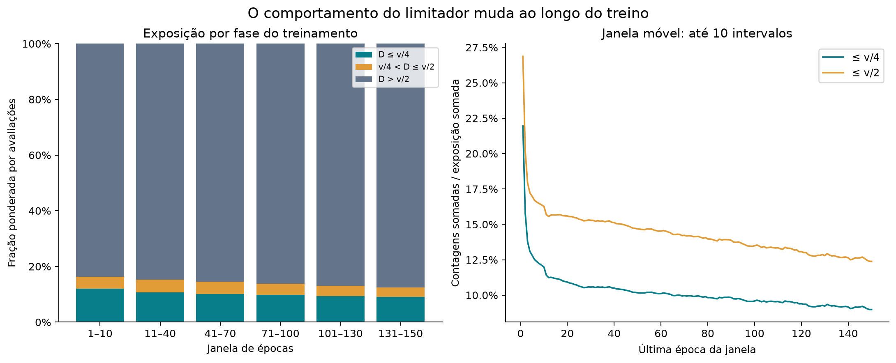
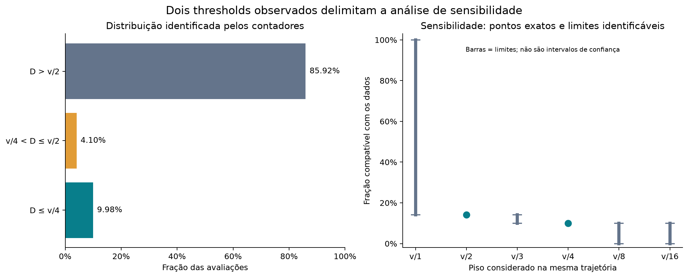
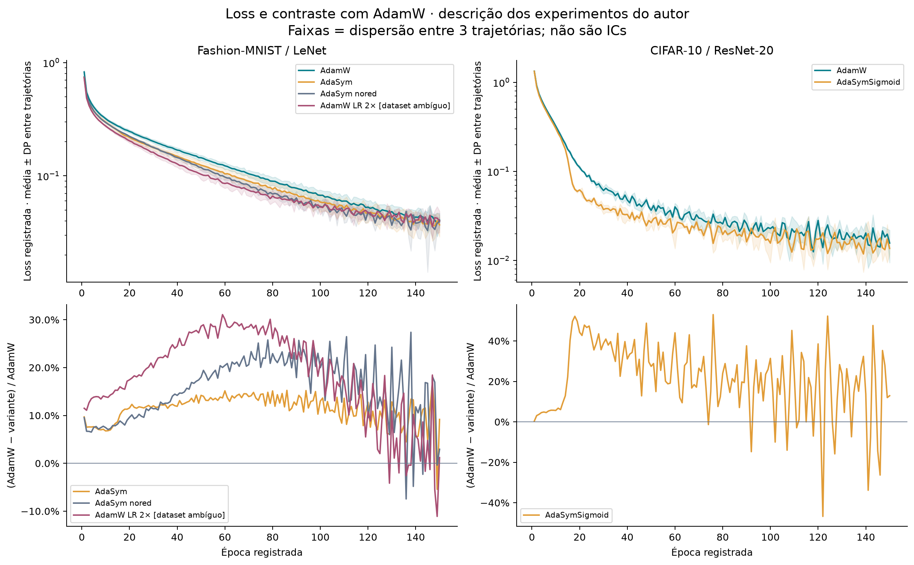
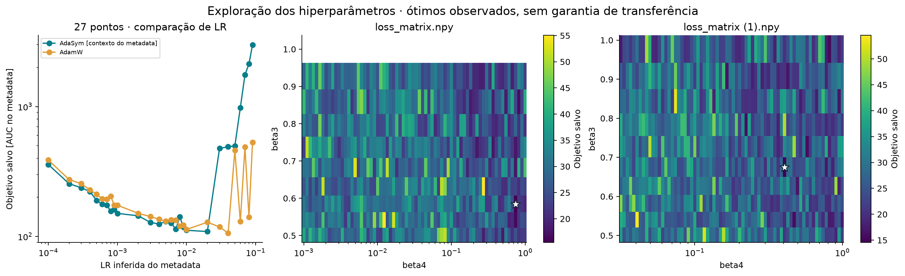

# AdaSym: investigação experimental orientada por dados

**Pesquisa de Ítalo Capuzzo · diagnóstico do otimizador, sensibilidade do threshold e evolução da fórmula.**

O AdaSym é uma pesquisa experimental em algoritmos de otimização para machine learning. Ítalo desenvolveu os experimentos, analisou curvas e estatísticas internas, identificou padrões e revisou hipóteses sobre a regra de atualização. Ciência de dados faz parte dessa metodologia: as visualizações participam da investigação e da evolução da fórmula, além da comunicação dos resultados. Os números a seguir quantificam os registros dessa pesquisa; não representam novos treinamentos.

## 1. Perguntas que orientam o diagnóstico

| Pergunta | Evidência examinada | O que se pode responder |
|---|---|---|
| O piso domina a atualização ou atua em uma parcela das avaliações? | c4 / full | Incidência do limite v/4 |
| Quanto muda a incidência ao considerar v/2? | c2 − c4 e c2 / full | Sensibilidade observada a dois thresholds na mesma trajetória |
| A incidência permanece constante ao longo do treino? | Diferenças dos contadores acumulados | Mudança temporal por intervalo e fase |
| Menor loss inicial implica melhor loss final? | Curvas, AUC, trecho final e controle LR 2× | Compromissos entre velocidade e qualidade tardia |
| Um mínimo isolado basta para escolher uma fórmula? | Grades de betas e LR | Configurações promissoras e regiões inválidas, com limites de seleção |

## 2. A evolução da fórmula é parte do raciocínio científico do autor

A apresentação do autor registra uma sequência de regras: expressão descoberta, quadrado da memória, piso relativo, memória separada e peso temporal. Segundo o relato de Ítalo, a análise dos dados e a identificação de padrões participaram das conclusões que conduziram a essa evolução. Os slides e arrays documentam a sequência e os testes; não oferecem um diário que associe cada alteração a uma única execução específica.

| Etapa documentada | Regra do denominador | Questão investigada |
| --- | --- | --- |
| Expressão inicial | sqrt(abs(v − m1)) | Explorar uma regra candidata encontrada na busca simbólica |
| Quadrado da memória | sqrt(abs(v − m1²)) | Relacionar a memória à escala de segundo momento |
| Piso relativo | sqrt(max(v − m1², v/c)) | Limitar a amplificação e investigar frequência de saturação |
| Memória separada | sqrt(max(v − m2², v/c)) | Investigar coeficientes próprios no denominador |
| Peso temporal | sqrt(max(v − s(e)·m2², v/c)) | Investigar a duração da correção de consistência |

Essa leitura conecta formulação, observação e revisão de hipóteses. O diagnóstico dos contadores mostra quando o mecanismo de proteção participa da atualização; as comparações de loss e LR investigam o resultado do treinamento. Esses dois níveis de evidência se complementam, mas frequência de saturação sozinha não determina qual fórmula tem melhor desempenho.

## 3. Threshold: definição, unidade e integridade

Considere D = v − s·m2² antes do piso e d = max(D, v/4). c4 conta avaliações com denominador ≤ v/4; c2 conta avaliações ≤ v/2; full conta o total de avaliações de gradientes/parâmetros. **São avaliações repetidas de coordenadas ao longo do treino, não parâmetros distintos, passos do otimizador ou réplicas estatisticamente independentes.**

O autor confirmou que “1550 epochs” no metadata significa **150 épocas**. A correção está em `data/author_clarifications.json`; o arquivo original foi preservado. Os contadores são inteiros, não negativos, crescentes e aninhados. A propriedade c4 ≤ c2 ≤ full também vale para os incrementos de cada intervalo.

Como os registros são acumulados, para a posição e usamos ΔC[e] = C[e] − C[e−1], com C[0] = 0. A taxa por intervalo é Δc4 / Δfull, e não c4 / full. Para janelas, somamos os numeradores e denominadores antes de dividir. Isso dá o peso correto à exposição de cada intervalo.

O total registrado é **1,460,922,532,104 avaliações**. O primeiro intervalo contém 4,896,411,590, enquanto o segundo contém 9,771,987,386 (50.11% da exposição de um intervalo posterior). A diferença de exposição é observada; sua causa não está documentada. Por isso, a primeira posição não é tratada automaticamente como uma época completa.

## 4. Quanto o limitador atua?

| Evento disjunto | Avaliações | Fração do total |
| --- | --- | --- |
| D ≤ v/4 | 145,766,992,885 | 9.9777% |
| v/4 < D ≤ v/2 | 59,869,969,114 | 4.0981% |
| D > v/2 | 1,255,285,570,105 | 85.9242% |

No histórico do autor, o limite v/4 foi alcançado em **9.98%** das avaliações. O conjunto até v/2 representa **14.08%**. A faixa intermediária soma **4.10 pontos percentuais** e corresponde a um aumento de **41.07%** sobre a incidência em v/4. As categorias c4 e c2 são aninhadas: somá-las diretamente produziria dupla contagem.

Esse padrão é incompatível com a descrição de que o piso v/4 domina todas ou quase todas as avaliações desse treinamento: **90.02%** ficam acima desse limite. Ao mesmo tempo, a incidência observada mostra que a proteção participa de uma parcela mensurável das atualizações. Ela não prova que o piso seja dispensável, nem mede quanto essas coordenadas contribuem para a norma do update ou para a redução da loss.



## 5. A sensibilidade varia ao longo do treinamento?

| Janela | ≤ v/4 | v/4 < D ≤ v/2 | ≤ v/2 |
| --- | --- | --- | --- |
| 1–10 | 11.984% | 4.282% | 16.266% |
| 11–40 | 10.663% | 4.670% | 15.333% |
| 41–70 | 10.080% | 4.396% | 14.476% |
| 71–100 | 9.746% | 4.029% | 13.775% |
| 101–130 | 9.389% | 3.679% | 13.068% |
| 131–150 | 9.073% | 3.437% | 12.511% |
| 141–150 | 8.986% | 3.401% | 12.387% |
| 1–150 | 9.978% | 4.098% | 14.076% |

Na janela 1–10, a incidência em v/4 é **11.98%**; na janela 141–150, é **8.99%**. A diferença é **-3.00 pontos percentuais** (-25.01% em termos relativos). A comparação descreve duas janelas escolhidas para exploração; não pressupõe uma queda monótona em todas as épocas nem define pontos de mudança estatisticamente estimados.

O acompanhamento por intervalo permite revisar a hipótese de incidência constante. As razões acumuladas retêm a influência do início e podem esconder mudanças recentes. As janelas móveis usam até dez intervalos e são ponderadas pela exposição, sem alterar os contadores.



## 6. Sensibilidade identificável e o que exige outra execução

Os dois contadores fornecem dois pontos observados da distribuição do denominador em relação a v. Para v > 0, são pontos da distribuição empírica de D/v em 1/4 e 1/2. A presença de v = 0 não foi registrada; por isso a análise usa os eventos relativos D ≤ v/k, sem criar razões individuais D/v que não estão nos arquivos.

| Piso considerado | Limite inferior de incidência | Limite superior | Identificação |
| --- | --- | --- | --- |
| v/1 | 14.076% | 100.000% | Somente limites |
| v/2 | 14.076% | 14.076% | Ponto observado |
| v/3 | 9.978% | 14.076% | Somente limites |
| v/4 | 9.978% | 9.978% | Ponto observado |
| v/8 | 0.000% | 9.978% | Somente limites |
| v/16 | 0.000% | 9.978% | Somente limites |

Esses limites vêm apenas da ordem dos eventos, sem interpolar uma densidade não observada. Eles se referem à mesma trajetória e não estimam como seria um novo treino com outro piso. Alterar o threshold muda os parâmetros, os gradientes futuros e os próprios momentos. As barras do gráfico são limites de identificação, não intervalos de confiança.

Para v > 0, mesmos momentos e epsilon desprezível, o piso v/4 limita o ganho da parte adaptativa a 2× em relação à normalização por sqrt(v). A região até v/4 fica no teto; a faixa v/4 < D ≤ v/2 corresponde a ganhos entre sqrt(2) e 2. Isso explica por que a investigação de Ítalo sobre saturação informa a interpretação da fórmula. A frequência dos eventos não recupera a distribuição completa dos ganhos nem seus efeitos causais na loss.



## 7. A loss responde a outra parte da hipótese

As matrizes 3 × 150 são resumidas por trajetória e por grupo. Não se presume pareamento entre linhas de arquivos diferentes. O arquivo 3 × 100 contém três métodos distintos, conforme a ordem inferida dos slides, e é exportado separadamente. AUC normalizada é a integral trapezoidal entre as posições 1 e N dividida por N−1; não é a média aritmética das N losses nem a AUC histórica das varreduras.

| Grupo | Método | AUC normalizada | Últimas 20: média ± DP entre trajetórias | DP temporal médio | RMS após remover tendência linear |
| --- | --- | --- | --- | --- | --- |
| Fashion-MNIST / LeNet | AdamW | 0.133193 | 0.043519 ± 0.006016 | 0.003417 | 0.002709 |
| Fashion-MNIST / LeNet | AdaSym | 0.118643 | 0.039634 ± 0.007385 | 0.003163 | 0.002635 |
| Fashion-MNIST / LeNet | AdaSym nored | 0.115411 | 0.039071 ± 0.003506 | 0.007535 | 0.007192 |
| Fashion-MNIST / LeNet | AdamW LR 2× [dataset ambíguo] | 0.107722 | 0.042096 ± 0.003853 | 0.005114 | 0.004787 |
| CIFAR-10 / ResNet-20 | AdamW | 0.077817 | 0.018017 ± 0.000344 | 0.004495 | 0.004334 |
| CIFAR-10 / ResNet-20 | AdaSymSigmoid | 0.065551 | 0.015440 ± 0.000432 | 0.004120 | 0.003997 |

O DP entre trajetórias descreve a variação de seus resumos finais. O DP temporal descreve a variação dentro da janela de cada trajetória e inclui tendência. O RMS residual remove apenas uma tendência linear. Nenhuma dessas medidas demonstra estabilidade teórica do otimizador. Sementes e split da loss não estão identificados.

O controle com LR 2× tem melhor resumo da curva inteira que AdaSym, enquanto AdaSym tem loss tardia menor nesse grupo de arquivos. A variante nored expõe outro compromisso: loss tardia baixa com maior variação temporal. Assim, a análise dos experimentos do autor examina o que significa “melhor”: acelerar o início, reduzir a loss final ou reduzir a oscilação. O conflito de rótulo do dataset no controle LR 2× permanece documentado.



O arquivo `convergence_targets.csv` mantém o resultado de cada trajetória para os alvos 0,05 / 0,1 / 0,2, exigindo 1 / 5 / 10 posições consecutivas. Campos de época vazios significam alvo não alcançado dentro do horizonte; nunca são substituídos por zero. Essas escolhas são exploratórias e permitem verificar a sensibilidade da descrição ao critério.

## 8. Exploração dos hiperparâmetros

Na grade de 27 LRs reconstruída do metadata, o mínimo do vetor associado a AdaSym é 109.020409 em LR 0.02; o mínimo de AdamW é 105.941498 em LR 0.04. Comparar métodos na mesma LR e comparar seus mínimos ajustados são perguntas diferentes. O significado AUC vem do metadata; o slide correspondente descreve outro resumo. A figura mostra o objetivo salvo sem resolver essa divergência.

As duas grades beta3/beta4 expõem a estrutura do objetivo e os valores inválidos. A grade `loss_matrix.npy` tem 70 valores não finitos, preservados como ausentes. Os mínimos são observações selecionadas na própria grade, sem repetições identificadas ou estimativa de incerteza. O vetor de 80 posições não recebe um eixo de LR inventado; o vetor de transição da sigmoide possui índices, mas endpoints exatos desconhecidos.



## 9. Conclusões e hipóteses que os dados permitem revisar

- **O limitador atua de forma seletiva neste histórico.** A incidência de v/4 é próxima de 10%, o que afasta a hipótese de saturação quase universal nessa execução.
- **O comportamento varia com a fase do treino.** Separar incrementos e acumulados revela mudanças temporais que um único percentual final não descreve.
- **O threshold altera a população atingida.** O evento até v/2 inclui uma faixa intermediária mensurável; dois pontos não identificam uma curva contínua de sensibilidade.
- **O ganho observado depende da métrica e do controle.** Curva inteira, loss tardia e LR maior precisam acompanhar qualquer interpretação sobre a fórmula.
- **A evolução da regra expressa uma investigação do autor.** Ítalo combinou busca de expressões, diagnóstico dos mecanismos e comparação experimental para desenvolver o AdaSym. As figuras documentam perguntas e padrões examinados nessa pesquisa.

Não há evidência para atribuir essas taxas a camadas específicas, neurônios, sinais dos gradientes ou épocas de uma curva de loss particular: os contadores são globais e não identificam a trajetória correspondente. Também não é possível calcular a contribuição para a norma do update, um efeito causal na generalização ou um “melhor threshold” a partir dessas contagens.

## 10. Continuação da investigação

Uma próxima rodada pode registrar D/v (se v > 0), ganho aplicado, norma do update e taxas por camada e por época, incluindo as avaliações com v = 0 em categoria própria. Comparar c = 2 / 4 / 8, com orçamento equivalente de ajuste de LR, permite relacionar saturação e resultado do treino. Registrar seeds, splits e IDs de execução vincula cada diagnóstico à sua loss e acurácia. Essa rodada deve separar a seleção de hipóteses dos dados usados para confirmá-las.

Não são calculados p-valores ou ICs binomiais sobre trilhões de avaliações correlacionadas. Frequências de coordenadas no mesmo treinamento não constituem trilhões de réplicas. Réplicas independentes e instrumentação completa são necessárias para quantificar incerteza entre treinamentos e testar efeitos da escolha do piso.

## Reprodução e tabelas

Na raiz do repositório:

```bash
python -m pip install -e ".[plots,docs]"
python scripts/analyze_research.py
python -m unittest discover -s tests -v
```

As tabelas CSV mantêm contagens inteiras, métricas por trajetória, alvos não alcançados, grades e limites de sensibilidade. `analysis_manifest.json` registra hashes dos dados, parâmetros da análise, arquivos-fonte e versões do ambiente. `report.html` incorpora todas as figuras e pode ser aberto sem internet. As figuras são exportadas em PNG e SVG.
